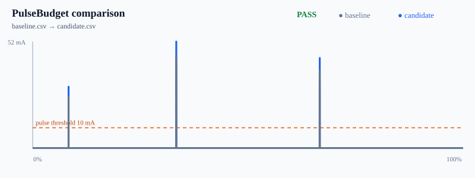

# PulseBudget

[](https://github.com/KanadeK/pulsebudget/actions/workflows/ci.yml)
[](https://github.com/KanadeK/pulsebudget/releases)
[](LICENSE)

**A Git diff for battery life.** PulseBudget turns current-profiler CSV traces into an
explainable firmware power diff, a reviewable report, and a CI budget gate.

[简体中文](README.zh-CN.md) · [Input and report formats](docs/FORMAT.md) ·
[Troubleshooting](docs/TROUBLESHOOTING.md) · [Research notes](docs/RESEARCH.md)



The committed demo finds a **31.81% average-current regression** and explains all of its
`+0.04988 mA`:

| Cause | Contribution |
| --- | ---: |
| Idle drift | +0.03014 mA |
| Higher pulse amplitude | +0.00869 mA |
| Longer/differently timed pulse activity | +0.01106 mA |

The three numbers are not heuristic labels. PulseBudget integrates them over a merged,
normalized timeline, and they must add back to the measured average-current delta.

## Why this exists

A firmware change can pass every functional test and quietly shorten battery life. Power
profilers show the waveform, but reviewers are often left comparing screenshots or headline
averages. PulseBudget accepts the CSV you already exported and answers three practical
questions:

- Did the candidate exceed a version-controlled power budget?
- Did consumption move while the device was idle, inside a pulse, or because pulse activity
  changed?
- Can CI and a human reviewer inspect the same deterministic evidence?

It is local, vendor-neutral, and dependency-free at runtime. There is no account, cloud upload,
live hardware control, or proprietary trace format.

## Quick start

### Run the standalone release

Download `pulsebudget-0.1.0.pyz` and `pulsebudget-0.1.0-examples.zip` from the
[latest Release](https://github.com/KanadeK/pulsebudget/releases/latest), extract the examples,
then run:

```bash
python pulsebudget-0.1.0.pyz compare examples/baseline.csv examples/candidate.csv \
  --budget examples/budget.json \
  --output pulsebudget-report
```

No package installation is required. Python 3.11 or newer is enough.

### Run from source

```bash
git clone https://github.com/KanadeK/pulsebudget.git
cd pulsebudget
uv sync --all-extras --frozen
uv run pulsebudget compare examples/baseline.csv examples/candidate.csv \
  --budget examples/budget.json \
  --output pulsebudget-report
```

Expected result:

```text
PASS: all applicable budget limits passed
```

The output directory contains:

- `report.json` — stable, machine-readable evidence.
- `report.md` — a pull-request-ready summary.
- `comparison.svg` — a self-contained visual diff.

Use `examples/budget-strict.json` to see the same valid comparison fail its 10% regression
budget and return exit code `1`.

## Commands

Analyze one trace:

```bash
pulsebudget analyze trace.csv --budget budget.json --output report
```

Compare a baseline and candidate:

```bash
pulsebudget compare baseline.csv candidate.csv --budget budget.json --output report
```

Map vendor-specific headers and units without editing the input:

```bash
pulsebudget analyze measurement.csv --budget budget.json --output report \
  --time-column "Timestamp (us)" --current-column "Current (uA)" \
  --time-unit us --current-unit ua
```

Exit codes are a public contract:

| Code | Meaning |
| ---: | --- |
| `0` | Every applicable budget limit passed. |
| `1` | Inputs were valid, reports were written, and at least one budget limit failed. |
| `2` | The command, trace, budget, or output destination was invalid. |

## Inputs

The default CSV format is deliberately small:

```csv
time,current
0,0.12
5.002,25
5.010,25
5.012,0.12
```

Times must be finite, non-negative, and strictly increasing. Current values must be finite and
non-negative. The default units are seconds and milliamps; `s`, `ms`, `us` and `a`, `ma`, `ua`
are supported explicitly.

A checked-in JSON budget defines what CI should protect:

```json
{
  "schema_version": 1,
  "pulse_threshold_ma": 10.0,
  "limits": {
    "max_average_current_ma": 0.25,
    "max_peak_current_ma": 60.0,
    "max_p95_current_ma": 0.2,
    "max_average_regression_percent": 10.0,
    "min_estimated_runtime_hours": 3000.0
  },
  "battery": {
    "capacity_mah": 1200.0,
    "usable_fraction": 0.8,
    "system_efficiency": 0.9
  }
}
```

Unknown fields are rejected, so a misspelled limit cannot silently pass. See
[the format reference](docs/FORMAT.md) for the exact schema and math.

## Add it to CI

Commit the known-good and candidate traces produced by your hardware job, then run:

```yaml
- name: Gate firmware power regression
  run: >-
    python -m pulsebudget compare
    power/baseline.csv power/candidate.csv
    --budget power/budget.json
    --output power/report
- name: Upload PulseBudget evidence
  if: always()
  uses: actions/upload-artifact@v4
  with:
    name: pulsebudget-report
    path: power/report/
```

Exit `1` is intentionally different from malformed input (`2`), so automation can distinguish a
real power regression from a broken measurement pipeline.

## What is measured

- Charge uses trapezoidal integration over real timestamps.
- Average current is integrated charge divided by trace duration.
- p95 is time-weighted over the piecewise-linear signal, not a percentile of CSV rows.
- Pulse boundaries are exact linear crossings of the configured threshold.
- Battery runtime is a transparent upper-bound estimate:
  `capacity × usable fraction × system efficiency ÷ average current`.
- Comparison normalizes both traces to progress `0..1`; it does not pretend separate captures
  have identical wall-clock timing.

## Honest boundaries

PulseBudget does not capture from hardware, infer a pulse threshold, model battery chemistry,
align semantic firmware events, denoise measurements, or prove statistical significance across
repeated runs. Give it comparable, already-prepared traces and an explicit budget. For noisy lab
measurements, compare aggregated or intentionally selected representative captures.

The [research notes](docs/RESEARCH.md) describe adjacent projects and the exact product boundary.
Novelty and stars can never be guaranteed; this release is designed around a specific unfilled
workflow rather than a popularity claim.

## Verify the release

From a source checkout with Python 3.11+ and `uv`:

```bash
uv sync --all-extras --frozen
uv run python scripts/release_check.py
```

That single gate runs formatting/lint checks, strict typing, the coverage suite, real example
pass/fail paths, wheel/sdist builds, the standalone `.pyz` smoke test, and the release manifest.
If it fails, follow the [failure-to-fix runbook](docs/TROUBLESHOOTING.md) and rerun the same
command.

## Project map

```text
CSV + budget JSON
       │
       ▼
strict boundary parser
       │
       ├── single-trace analysis ──► budget gate
       │
       └── normalized trace diff ──► exact attribution ──► budget gate
                                                    │
                                                    ▼
                                      JSON + Markdown + SVG
```

The executable specification is in [docs/SPEC.md](docs/SPEC.md), and the numerical-model
decision is recorded in
[ADR 0001](docs/decisions/0001-piecewise-linear-trace-model.md).

## Contributing and security

Read [CONTRIBUTING.md](CONTRIBUTING.md) before sending a change. Report vulnerabilities using
the private route in [SECURITY.md](SECURITY.md), not a public issue.

PulseBudget is available under the [MIT License](LICENSE).
